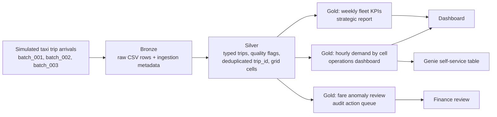

# CityFleet Taxi Demand, Revenue & Fare Quality Control Tower

## 1. Business Context and Pipeline Design

CityFleet is a hypothetical taxi fleet operator in New York City. Its operational problem is that demand varies sharply by hour and location, while managers also need longer-term evidence for fleet planning and fare-quality control. The same taxi trip dataset can serve three groups:

| Consumer | Decision supported | Cadence |
|---|---|---|
| Dispatch / operations managers | Identify pickup hotspots and reposition idle vehicles toward high-demand grid cells | Hourly / mini-batch |
| Fleet planning team | Understand weekly trips, revenue, active vehicles, active drivers, and payment mix | Weekly |
| Finance / audit team | Review suspicious fares, zero-distance paid trips, high tip ratios, and invalid GPS records | Daily / weekly |
| Business analysts using Genie | Ask self-service questions over curated Gold tables | Ad hoc |

The pipeline follows the course medallion pattern. Bronze stores raw files append-only so the source can be replayed. Silver casts and validates records into a deduplicated source of truth. Gold contains business-level tables designed for dashboards, scheduled reporting, audit review, and Genie.

## 2. Data Source and Arrival Pattern

The project uses the instructor-provided NYC taxi trip dataset. The source file is compressed CSV with no header. It contains approximately 2 million trips from 2013-01-01 to 2013-01-20. Fields include vehicle id, driver id, pickup/dropoff timestamps, trip duration, distance, GPS coordinates, payment type, fare, tip, tolls, and total amount.

Because the source dataset is static, incremental arrival is simulated by splitting it into time-ordered batches:

| Batch | Date range | Rows | Simulated role |
|---|---:|---:|---|
| batch_001 | 2013-01-01 to 2013-01-04 | 864,187 | Initial load |
| batch_002 | 2013-01-05 to 2013-01-14 | 599,783 | Refresh iteration 1 |
| batch_003 | 2013-01-15 to 2013-01-20 | 536,029 | Refresh iteration 2 |

Each refresh processes the next unprocessed file from the landing volume. The demonstration therefore shows Bronze growing, Silver being incrementally merged, and Gold being recomputed.

## 3. Medallion Implementation Summary

### Bronze

Table: `bronze_taxi_raw`

Bronze stores all 17 source columns as strings, preserving the raw representation. It adds `source_file`, `ingestion_batch_id`, `ingestion_timestamp`, and `raw_row_hash`. This layer is append-only and does not apply business cleaning.

### Silver

Table: `silver_taxi_trips`

Silver casts the raw columns to analytical types and creates a stable `trip_id` from vehicle, driver, timestamps, distance, and total amount. It computes pickup/dropoff grid cells using the provided starter-notebook logic. It also validates coordinates, timestamps, distance, and financial values.

Silver quality rules:

- Valid NYC-area pickup and dropoff coordinates.
- Non-null pickup and dropoff timestamps.
- Dropoff timestamp must be after pickup timestamp.
- Positive trip duration and distance.
- Non-negative fare/tip and positive total amount.
- Deduplication by `trip_id` using `MERGE INTO`.

The table keeps quality flags and a `clean_trip` boolean, so bad records are visible instead of silently disappearing.

### Gold

Table: `gold_hourly_demand_by_cell`

This table groups clean trips by date, hour, and pickup grid cell. It contains trip count, active vehicles, active drivers, total revenue, average fare, average distance, card/cash share, and a demand score. It feeds the operational dashboard.

Table: `gold_weekly_fleet_kpis`

This table aggregates weekly trips, revenue, active vehicles, active drivers, average revenue per trip, payment mix, trips per vehicle, and revenue per vehicle. It feeds the strategic planning report.

Table: `gold_fare_anomaly_review`

This table identifies trips requiring review. Rules include high total amount, zero-distance paid trips, high tip ratio, nonpositive duration, and invalid coordinates. It feeds a finance/audit action queue.

Table: `gold_genie_taxi_summary`

This table is a business-readable version of hourly demand, with clearer column names such as `service_date`, `service_hour`, `pickup_area_latitude`, and `pickup_area_longitude`. It is intended for Databricks Genie self-service analysis.

## 4. Consumer Outputs and Actions

The implemented consumer output is a Databricks dashboard built from Gold tables. The dashboard includes:

- Latest-hour demand hotspots by pickup area.
- Hourly demand and revenue trend.
- Weekly fleet KPIs.
- Fare anomaly review queue.

Actions supported:

- Dispatch managers can direct drivers toward cells with high demand scores.
- Fleet planners can adjust driver incentives and coverage schedules for high-demand days/hours.
- Finance/audit users can investigate trips with fare anomalies or invalid trip structure.
- Analysts can use Genie to ask natural-language questions without querying Bronze or Silver.

## 5. Genie Experience

Suggested Genie questions:

- Which service date and hour had the highest number of taxi trips?
- Which pickup areas had the highest demand score in the latest available hour?
- How did total revenue and active vehicles change by week?
- What are the most common fare anomaly reasons?
- Which hours have the highest card payment share?

Expected result: Genie should work best on `gold_genie_taxi_summary` because its column names are business-readable and the table has a focused grain. If Genie struggles with geospatial wording such as "area" or "hotspot", the report should mention that using explicit latitude/longitude names and table comments improved the results.

## 6. Production Discussion

The prototype uses Databricks Free Edition and simulated file arrivals. In production, the landing process would be automated. If the source were TLC trip files arriving periodically, Auto Loader could ingest new files from S3, Azure Blob, or GCS into Bronze. If trip events arrived continuously from dispatch systems, Kafka or Event Hubs could feed a Structured Streaming job.

Compute would move from Free Edition serverless quotas to production jobs or multi-node clusters. Storage would move from workspace volumes to governed cloud object storage. Unity Catalog would manage table permissions, lineage, and access by role. Monitoring would track late/missing files, failed jobs, quality-rule failure rates, anomaly volumes, and dashboard freshness.

At full scale, Bronze retention could keep raw history cheaply, Silver could be partitioned by pickup date, and Gold refreshes could be incremental rather than fully recomputed. The operational demand table could refresh every 5-15 minutes, while weekly KPIs could refresh nightly or weekly.

## 7. AI Tools Usage

AI tools used: OpenAI Codex in the Codex desktop environment. Usage was agentic: Codex read the project description and course materials, inspected the dataset files, profiled the taxi data, generated time-ordered arrival batches, created Databricks notebooks, and drafted the README/report content.

Development strategy: design-first and schema-guided. First, Codex compared the available datasets against the grading criteria and selected the taxi dataset. Then it designed the organisational process and medallion architecture. Finally, it iterated on Silver and Gold schema choices so that the dashboard and Genie consumers would use business-readable curated tables rather than raw source data.

Reflection: AI was most useful for connecting the assignment rubric to an implementable pipeline and for producing reproducible notebooks quickly. The main limitation is that Codex could not directly execute the notebooks inside the Databricks Free Edition workspace, so final screenshots, dashboard creation, and Genie testing must be completed manually in Databricks.

